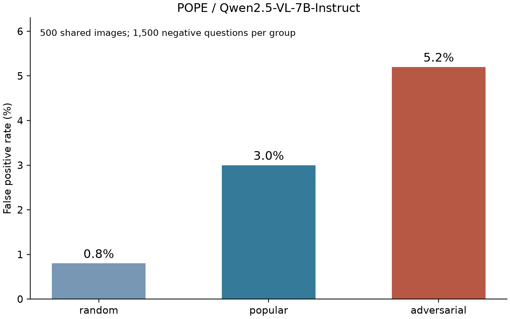

# 视觉语言模型的物体存在性幻觉
在 POPE 上复现 Qwen2.5-VL-7B-Instruct 基线，并通过同图同题的提示词对照，研究误报与漏检之间的关系。

## 实验与结果
第一轮覆盖 500 张图片、9,000 道题。按照官方标签，随机、高频、共现三组的误报率依次为 0.80%、3.00%、5.20%。误报率统计负例中回答“有”的比例，召回率统计正例中回答“有”的比例。



第二轮按图片划分 100 张开发图和 400 张后续评测保留图。划分前已分析全量基线，曾查阅的 23 张图进入开发组。固定图片、模型、解码和评分方式，改变问题末尾的指令。下表为 400 张保留图的共现组，每种提示含 1,200 道正例和 1,200 道负例。

| 提示 | 误报率 | 召回率 |
|---|---:|---:|
| A 用一个词或短语回答 | 3.42% | 78.00% |
| B 回答是或否 | 2.58% | 74.75% |
| C 依据图中可见证据，回答是或否 | 3.92% | 78.67% |

C 相对 B 净多认出 47 个正例，也净多误报了 16 个负例。按图片配对重采样 10,000 次，误报率差为 +1.33 个百分点（95% 区间 +0.67 至 +2.00），召回率差为 +3.92 个百分点（+2.83 至 +5.08）。这项观察限于该模型、提示词和数据集。下一步计划盲审共现组中 B、C 判定发生变化的 65 道题。

## 复现
实测使用 Linux、Python 3.10、PyTorch 2.6.0+cu126 及一张 48 GB GPU。在可用的 CUDA 与 PyTorch 环境中，从仓库根目录运行以下命令。评测任务需要 Hugging Face 登录。可通过 MODEL 环境变量指定本地模型目录。

```bash
bash setup.sh
source .venv/bin/activate
export HF_HOME="$PWD/cache/huggingface"
hf auth login
bash run.sh smoke
bash run.sh full
bash second_round/run.sh dev
bash second_round/run.sh test
```

results/baseline 保存第一轮统计。results/dev 和 results/test 保存第二轮统计、配对比较和精确提示词。second_round/image_split.json 记录图片划分。安装脚本固定了评测框架提交版本，其余 Python 依赖随环境解析。

## 项目来源
- [POPE 基准与作者代码](https://github.com/RUCAIBox/POPE)
- [本实验使用的 POPE 数据](https://huggingface.co/datasets/lmms-lab-encoder/POPE)
- [Qwen2.5-VL-7B-Instruct](https://huggingface.co/Qwen/Qwen2.5-VL-7B-Instruct)
- [lmms-eval 评测框架](https://github.com/EvolvingLMMs-Lab/lmms-eval)
